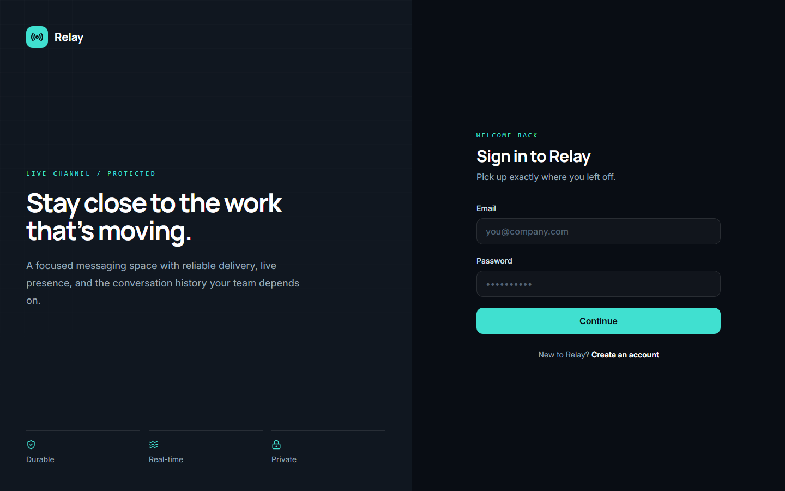
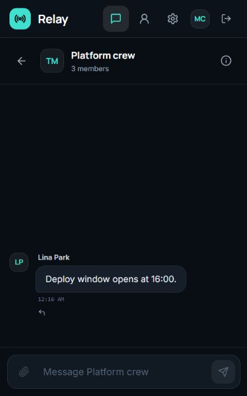
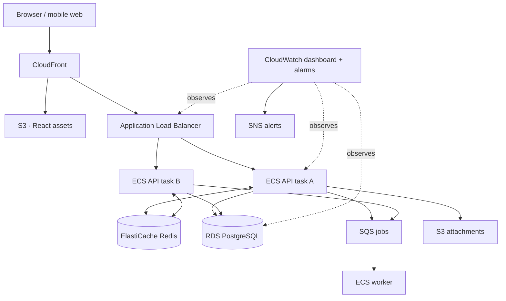
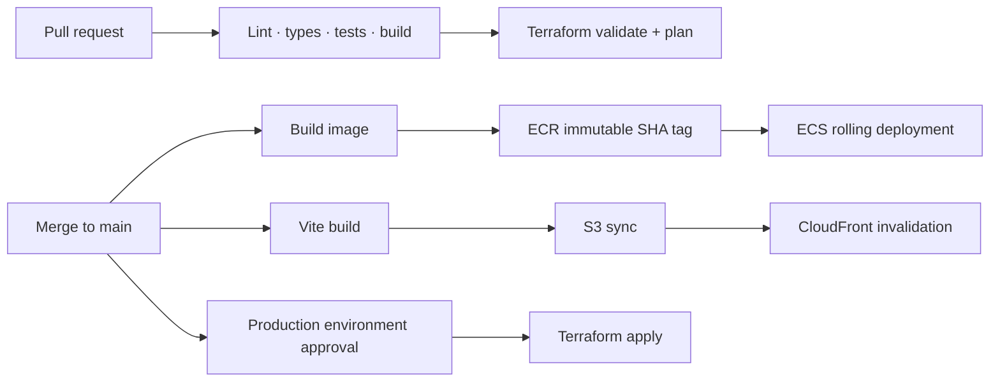

# Relay

Relay is a real-time messaging application built with React, TypeScript, Node.js, PostgreSQL, Socket.IO and Redis, with tests for message persistence, authorization, multiple API instances and failure recovery.

It supports account creation, direct and group conversations, cursor-paginated history, idempotent sends, optimistic UI, editing/deletion/replies, typing indicators, online presence, per-user delivery/read receipts and profile management. S3 attachment and SQS audit-job integrations exist in the source but are disabled in the deployed demo.





**[Live demo](https://3.131.19.155)** — the October 27, 2026 snapshot runs on one AWS EC2 host in `us-east-2`, with HTTPS, two API containers, PostgreSQL and Redis. The demo uses a fresh cloud database and has no seeded public credentials. Availability depends on the demo remaining active.

The managed ECS/RDS/ElastiCache/CloudFront architecture below is an **unapplied Terraform design**. Production deployment workflows remain disabled. The demo has no high availability, independent off-host backups, live CloudWatch application dashboard or SNS failure alerts. The full original specification is not complete.

See [requirements status](docs/requirements-status.md), [deployment report](docs/demo-launch-report.md), [test evidence](docs/verification.md) and the [logout follow-up](docs/logout-fix-20261027.md) for implemented, deployed and unverified scope. Latest recorded results include 30 backend tests and 21 frontend tests; local load results do not establish AWS capacity.

## Intended production architecture



Messages are committed to PostgreSQL before Socket.IO publishes through Redis and acknowledges the sender. A recipient connected to a different API task receives the event. If real-time delivery is interrupted, the client reconnects, rejoins authorized rooms, and refetches persisted history.

## Stack

| Layer           | Technology                                        | Why it exists                                                            |
| --------------- | ------------------------------------------------- | ------------------------------------------------------------------------ |
| Client          | React, TypeScript, Vite, TanStack Query, Tailwind | Responsive UI, server-state caching, optimistic sends                    |
| API             | Node.js, Express, Zod, Prisma                     | Validated REST fallback and shared business rules                        |
| Live transport  | Socket.IO + Redis adapter                         | Authenticated rooms and cross-instance event fan-out                     |
| Durable state   | PostgreSQL / RDS                                  | Transactional source of truth for users, membership, messages, receipts  |
| Ephemeral state | Redis / ElastiCache                               | Socket coordination, multi-connection presence, expiring typing state    |
| Background work | SQS + ECS worker                                  | Decouples non-critical work from message latency                         |
| Files           | Private S3 + signed URLs                          | Direct uploads without proxying file bytes through Node                  |
| Runtime         | Docker, ECS Fargate, ALB                          | Repeatable containers, multiple tasks, WebSocket upgrades                |
| Infrastructure  | Terraform                                         | Reproducible private networking, data services, IAM, monitoring          |
| Delivery        | GitHub Actions + OIDC                             | Test, build, immutable images, ECS/S3 deployment without static AWS keys |

## Product features

- HTTP-only cookie authentication with bcrypt password hashing and expiring JWTs
- Direct conversations are unique per user pair; groups support owner/admin/member roles
- Server-authoritative timestamps and deterministic message ordering
- `clientMessageId` idempotency prevents duplicate messages after retries
- Cursor pagination loads older history without large offsets
- Optimistic send states: sending, sent, delivered, read, and failed
- Redis-backed Socket.IO rooms work across multiple backend processes
- Presence handles multiple tabs/devices before marking a user offline
- Typing state expires automatically and is never persisted in PostgreSQL
- Per-recipient delivery/read receipts and efficient unread counts
- Soft message deletion, bounded editing window, and membership checks on every access path
- Pre-signed, private S3 attachment upload/download URLs with type and size validation
- Structured Pino logs with request IDs and sensitive-field redaction

## Run locally

The supported local runtime is Node 24+ and Docker Desktop. Older Node versions are not supported by the current build/test dependencies.

```bash
docker compose up --build
```

Open `http://localhost:8080`. Compose starts PostgreSQL, Redis, a migration task, **two API replicas**, and the frontend reverse proxy. The proxy balances API/WebSocket connections across both replicas; Redis carries events between them.

On Windows, if the default Docker context targets an unavailable engine, use `docker --context desktop-linux compose ...` for these commands. This does not change your global Docker context.

To seed sample accounts after startup:

```bash
docker compose run --rm migrate ./node_modules/.bin/tsx backend/prisma/seed.ts
```

All seeded users use `RelayDemo123!`; emails are `maya@relay.local`, `theo@relay.local`, and `lina@relay.local`. These are local demo credentials only.

For host-based development:

```bash
cp .env.example backend/.env
npm install
npm run prisma:migrate -w backend
npm run dev
```

The Vite client runs on port 5173 and proxies to the API on port 3000.

## Test and build

```bash
npm run lint
npm run typecheck
npm test
npm run build
```

Unit and frontend tests run without infrastructure. Integration and WebSocket tests require PostgreSQL and Redis:

```bash
RUN_INTEGRATION_TESTS=true npm run test -w backend
```

CI provisions both services, applies Prisma migrations, then runs lint, type checks, unit/integration/socket tests, builds, `terraform fmt -check`, and `terraform validate`.

The socket integration suite starts two separate HTTP/Socket.IO servers, connects a different user to each, and uses the real Redis adapter to verify delivery, receipts, multi-tab presence, and reconnect recovery. Docker Compose provides the same two-instance topology. Tests refuse to wipe any database whose name does not end in `_test`.

On PowerShell, enable integration tests with `$env:RUN_INTEGRATION_TESTS='true'` and use a separate `relay_test` database. See [testing](docs/testing.md) for the exact setup.

## API at a glance

| Area          | Endpoints                                                                               |
| ------------- | --------------------------------------------------------------------------------------- |
| Auth          | `POST /api/auth/register`, `POST /login`, `POST /logout`, `GET /me`                     |
| Users         | `GET /api/users/search?q=`, `GET /api/users/:id`, `PATCH /api/users/me`                 |
| Conversations | `GET/POST /api/conversations`, `GET/PATCH/DELETE /:id`                                  |
| Membership    | `POST /api/conversations/:id/members`, `DELETE /:id/members/:userId`, `POST /:id/owner` |
| Messages      | `GET/POST /api/conversations/:id/messages`, `PATCH/DELETE /api/messages/:id`            |
| Files         | `POST /api/attachments/presign`, `GET /api/attachments/:id/url`                         |
| Read state    | `POST /api/conversations/:id/read`                                                      |
| Health        | `GET /api/health`, `GET /api/health/ready`, `GET /api/config`                           |

See [API reference](docs/api.md) and [WebSocket events](docs/websocket-events.md) for payloads and error behavior.

## Reliability and security

Relay deliberately claims **persist once, attempt live delivery, recover from PostgreSQL**—not exactly-once distributed delivery. A unique `(senderId, clientMessageId)` constraint makes client retries idempotent. Every REST route and socket event derives the sender from the verified session and rechecks conversation membership; client-supplied user IDs are never accepted as sender identity.

The application uses Helmet, explicit CORS/origin checks, Zod schemas, Prisma parameterization, endpoint/socket rate limits and redacted structured logs. Production cookies are `Secure`, `HttpOnly`, and `SameSite=Lax`. The demo stores generated secrets in root-only files on its encrypted disk and isolates PostgreSQL/Redis on private Docker networks. Private managed-data subnets, Secrets Manager and ECS task roles belong to the unapplied production design.

## AWS and delivery

Terraform source defines a VPC with public ALB subnets and private ECS/RDS/Redis subnets, a NAT gateway, ECR, ECS Fargate API/worker services, RDS PostgreSQL, ElastiCache Redis with TLS and failover, private S3 buckets, CloudFront, SQS/DLQ, Secrets Manager, CloudWatch, SNS and autoscaling. This stack has not been applied; the EC2 demo is managed separately.



Deployment setup and required GitHub variables are documented in [deployment](docs/deployment.md). The AWS resources and workflows are source code, not evidence of an actual deployment. Provisioning requires your AWS credentials, state backend, validated ALB origin certificate, DNS configuration, and GitHub environments.

Cloud workflows are opt-in: leave repository variable `AWS_DEPLOYMENT_ENABLED` unset/false to avoid cloud deployment. With a $0 cloud budget, use the working local Docker stack; no free AWS capacity is assumed.

See [the $0-budget runbook](docs/zero-budget.md) for this mode and its limits.

## Monitoring

CloudWatch receives ECS logs and infrastructure metrics. The Terraform dashboard covers ALB request count/latency/5xx, ECS CPU/memory, RDS connections/CPU/storage, Redis connections, and SQS backlog. SNS alarms cover high 5xx, unhealthy targets, ECS resource pressure, RDS pressure/low storage, Redis CPU, and queue backlog. See [operations](docs/operations.md).

## Load tests

Install [k6](https://grafana.com/docs/k6/latest/set-up/install-k6/) and use a dedicated test account/environment:

```bash
k6 run -e BASE_URL=https://your-relay.example \
  -e RELAY_EMAIL=load@example.com -e RELAY_PASSWORD='…' load-tests/k6/http.js
```

Real local runs and raw summaries are recorded in [verification](docs/verification.md), including failed probes and subsequent fixes. The qualified 100/500-connection burst probes and 1,000-connection paced probe verify persistence as well as live delivery against the original one-second p95 targets. These short connection/fan-out probes use two accounts and one sender; they do not establish 1,000-user capacity, burst admission at 1,000 connections, sustained throughput, or AWS performance. See [testing](docs/testing.md) for scenarios and responsible ramp-up.

## Repository map

```text
backend/                  Express, Prisma, Socket.IO, worker, tests
frontend/                 React/Vite/Tailwind client
infrastructure/terraform/ AWS infrastructure and alarms
load-tests/k6/            HTTP and WebSocket scenarios
docs/                     Architecture, protocol, deployment, operations
.github/workflows/        CI and OIDC deployment pipelines
```

## Further documentation

- [Requirements and completion status](docs/requirements-status.md)
- [Current demo deployment](docs/demo-launch-report.md)
- [Architecture decisions](docs/architecture.md)
- [API reference](docs/api.md)
- [WebSocket protocol](docs/websocket-events.md)
- [Testing and failure drills](docs/testing.md)
- [Executed verification and limitations](docs/verification.md)
- [AWS deployment](docs/deployment.md)
- [Operations and alerts](docs/operations.md)
- [Threat model](docs/security.md)

## License

MIT — see [LICENSE](LICENSE).
